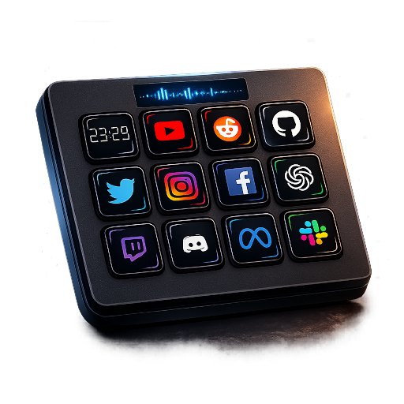
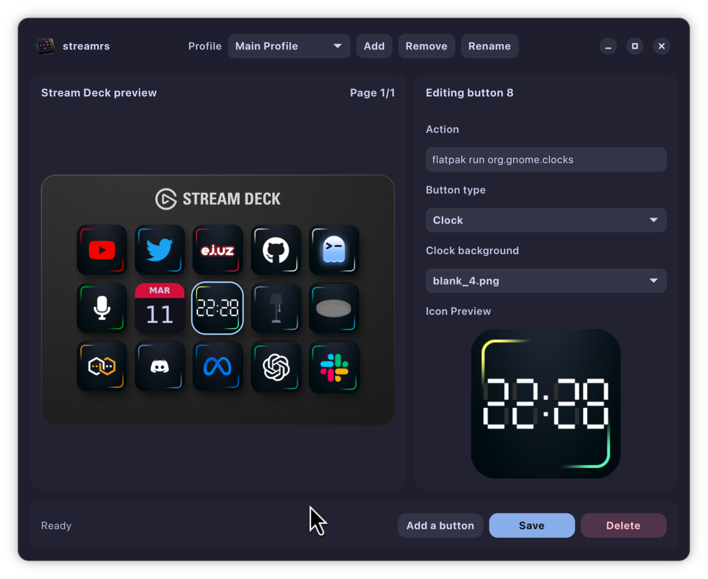

<!-- LOGO -->
<h1 align="center">
  
  <br>streamrs
</h1>

<p align="center">
  A lightweight Rust Stream Deck toolkit for Linux.
  <br />
  <a href="#about">About</a>
  ·
  <a href="#download">Download</a>
  ·
  <a href="#documentation">Documentation</a>
  ·
  <a href="development.md">Developing</a>
</p>

<p align="center">
  
</p>

## About

`streamrs` is a lightweight Stream Deck toolkit focused on a simple Linux-first workflow for configuring keys, icons, and actions on Stream Deck hardware.

It is built for and tested on:
- Elgato Stream Deck MK.2
- USB ID `0fd9:0080`

Feature highlights:
- Static icons: PNG, JPEG/JPG, SVG
- Animated icons: GIF, APNG, animated WebP
- Built-in clock icon (`clock.svg`)
- Status-driven toggle icons via polling commands
- Keyboard shortcut actions
- Automatic pagination when config has more than 15 keys

## Download

Install a release `.deb` (recommended on Debian/Ubuntu):

Release files are published on the GitHub Releases page:
- https://github.com/EriksRemess/streamrs/releases

```bash
sudo apt install ./streamrs_<version>_amd64.deb
```

Quick start after install:
1. Plug in the Stream Deck
2. Open the GUI: `streamrs-gui`
3. Edit buttons and save

Service behavior:
- On install, `streamrs.service` is enabled and started for active logged-in regular users
- On package upgrade, the service is restarted for active logged-in regular users
- To enable it for an additional user later, log into that user and run:

```bash
systemctl --user enable --now streamrs.service
```

- On each service start/restart, `streamrs --init --force-images` runs first:
  - creates a config if missing
  - refreshes bundled images from the package
  - keeps your existing config unless you explicitly run `streamrs --init --force`

## Documentation

### Running and Service Management

Open the GUI configurator:

```bash
streamrs-gui
```

Manually start the daemon (if you do not want to use the service):

```bash
streamrs
```

Useful service commands:

```bash
systemctl --user status streamrs.service
systemctl --user restart streamrs.service
systemctl --user stop streamrs.service
```

### Profiles and File Locations

Default profile files live in:
- Config: `~/.config/streamrs/default.toml`
- Images: `~/.local/share/streamrs/icons/`
- Runtime state: `~/.local/state/streamrs/state.toml`

Additional profiles use:
- `~/.config/streamrs/<name>.toml`
- Shared icons in `~/.local/share/streamrs/icons/`

Notes:
- If the config is missing, `streamrs` auto-initializes the profile from bundled defaults
- `streamrs --init --force` refreshes config and bundled images from package defaults
- Runtime state such as persisted portal permission restore tokens is stored separately from editable profile config

### Device information

Run `streamrs --info` or open **Menu → Device information** in the GUI. Both show the matching deck’s USB ID, serial number, firmware versions and checksums, key and display dimensions, and hardware sleep timer. They also show the reported image BPP, color scheme code, key and LCD gallery image counts, and demo frame count when the firmware supplies them. The query can run while the daemon is active. Use `--profile <name>` or `--config <path>` to select the HID identifiers for the CLI.

### Compare a local firmware image

Run `streamrs --compare-firmware 20GBA9901.bin` or open **Menu → Compare firmware image…**. This reads the connected MK.2’s primary (AP2) version and checksum and compares both with the local image. It checks the model identifier, payload length, and CRC-32 before reporting a result. The standard MK.2 and scissor-key MK.2 use different images. This comparison is read-only. The CLI exits successfully on a match and returns a nonzero status for a difference or an error.

### Test a display color

Use `streamrs --fill-lcd 224466` for the whole display, or `streamrs --fill-key 1 FF8000` for the top-left key. Numbers run from 1 to 15, left to right from the top row. Colors are six hexadecimal RGB digits. In the GUI, open **Menu → Test display color…** and choose the target and color. A whole-display fill also colors the gaps around the keys. A single-key fill changes only that key face. The fill is temporary and the daemon may redraw individual keys during the test. Changing pages restores the new page and its gaps. To redraw the current page immediately, run `systemctl --user kill --signal=HUP --kill-whom=main streamrs.service` with the rebuilt daemon running.

### Page wallpapers

Open **Menu → Page wallpaper…** on the page you want to change. Choose a PNG, JPEG or WebP image, or remove the existing wallpaper. The selection is saved to that profile immediately. Keep the selected file at its original location.

streamrs center-crops the artwork to a 480 × 272 canvas. Empty key faces show their portion of the wallpaper. The gaps stay black, and configured buttons keep their usual appearance, including transparent icons, clocks and status indicators. The GUI and `streamrs-preview` show the visible portions.

You can also set wallpapers in a profile. Page numbers start at one. Relative paths use the icons directory.

```toml
[page_wallpapers]
"1" = "landscape.png"
"2" = "/home/me/Pictures/night.jpg"
```

### Display brightness

Use `streamrs --brightness 35` to save 35% brightness in the current profile and apply it to the connected deck. Use `--profile <name>` to select another profile or `--config <path>` to select a config file. The range is 0–100%. The command works with the daemon stopped. If the deck is unplugged, the daemon applies the saved value the next time it connects with that profile.

In the GUI, open **Menu → Brightness…**, adjust the slider and choose **Apply**.

### Standby image

On a standard MK.2 (USB ID `0fd9:0080`), run `streamrs --standby-image ~/Pictures/standby.png` or choose **Menu → Device information → Set standby image…**. streamrs center-crops the image to 480 × 272 and uploads it to device flash. The same image applies across profiles and the deck keeps it after the source file is removed.

On a clean service stop or Ctrl+C, the daemon asks the deck to display its stored standby image. The factory logo works without any setup. The next daemon start redraws the active profile. If a second daemon starts, it waits for an available deck. You can upload a standby image while the daemon is running.

### Sleep after inactivity

Use `streamrs --sleep-after 10` to put the connected deck to sleep after ten idle minutes. Use `streamrs --sleep-after never` (or `0`) to disable the timer. In the GUI, open **Menu → Device information → Change sleep timer…**.

The timer applies to the whole device immediately. You can change it while the daemon is running and check it with `streamrs --info`. The same `--profile` and `--config` options select the target device.

On the MK.2 running firmware `1.02.000`, the deck sleeps with a clock key active. The first key press wakes the display. Press the key again to run its action.

### CLI Basics

Common `streamrs` flags:
- `--profile <name>`: use another profile
- `--config <path>`: use a custom config file
- `--debug`: inherit child process stdout/stderr
- `--init`: initialize profile files and exit
- `--force`: with `--init`, overwrite existing config/images

### Actions

Each key can either launch a command or trigger a keyboard shortcut. Quote arguments that contain spaces. Launch actions execute the program directly, so variables and shell operators are passed literally.

Example command action:

```toml
[[keys]]
action = "open https://github.com/EriksRemess/streamrs"
icon = "github.png"
```

Example keyboard shortcut action:

```toml
[[keys]]
shortcut = "Ctrl+Shift+T"
icon = "shortcut-example.png"
```

Notes:
- If both `action` and `shortcut` are set, `shortcut` takes precedence
- Shortcuts support common modifiers and keys such as `Ctrl`, `Alt`, `Shift`, `Meta`, function keys, arrows, `Return`, and single characters
- On GNOME Wayland, shortcut injection uses the RemoteDesktop portal and may show a permission prompt the first time
- If the portal backend grants persistence, `streamrs` stores the restore token in `~/.local/state/streamrs/state.toml` to reduce future prompts

### Status Buttons

Status buttons can poll a shell command and swap icons based on its exit code.

Example:

```toml
[[keys]]
action = "playerctl play-pause"
status = "playerctl status | grep -q Playing"
status_interval_seconds = 5
icon_on = "pause.png"
icon_off = "play.png"
```

Notes:
- `status_interval_seconds` controls the regular polling interval in seconds
- Existing `status_interval_ms` values are still supported for older configs
- Pressing a button with an action triggers a status refresh 1 second after the action command succeeds

### Preview Renderer

Generate a mock image from your current profile:

```bash
streamrs-preview --output mock.png
```

Render the second page of a profile:

```bash
streamrs-preview --profile test --page 2 --output page-2.png
```

Notes:
- Page numbers start at 1. Omitting `--page` renders the first page.
- If `--output` is omitted, it writes `mock.png`
- If `--profile` is omitted, it uses the current profile from `~/.config/streamrs/current_profile` (or `default` if unset)
- It reads the selected profile config and shared icons first, then falls back to packaged defaults if needed

### Icon Composer

Create a Stream Deck icon from a logo (`.svg` or `.png`):

```bash
streamrs-icon-compose path/to/logo.svg
```

Defaults:
- Output directory: `~/.local/share/streamrs/icons/`
- Output name: `<logo>-icon.png` (auto-suffixed if needed)

Options:
- `--output <path>`
- `--padding <ratio>` (0.0..0.5)

## Developing

Developer-focused setup, source builds, packaging, maintainer notes, and contribution guidance are in [development.md](development.md).

## Credits

- Icon pack source: https://marketplace.elgato.com/product/hexaza-3d4ed1dc-bf33-4f30-9ecd-201769f10c0d

## License

MIT. See [LICENSE](LICENSE).
